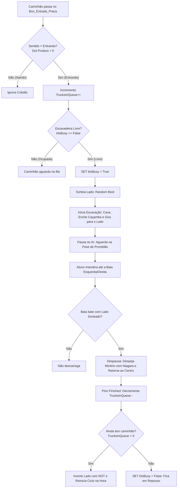

# Documentação Técnica: Carregamento Bilateral e Gestão de Fila (PC8000)

Este documento descreve detalhadamente a lógica de **Carregamento Bilateral com Fila de Caminhões e Espera na Praça** implementada no Blueprint `BP_ChaosPC8000` (Unreal Engine 5). 

Ele serve como guia arquitetural para replicar a mecânica em outras escavadeiras (ex: Cat, Liebherr, P&H) ou adaptar para escavadeiras cujas animações funcionem por métodos diferentes (Anim Montages, Control Rig, Splines, etc.).

---

## 1. Visão Geral do Ciclo Operacional

Na mineração a céu aberto real (*Double-Sided / Bilateral Loading*), o caminhão fora-de-estrada é guiado visualmente pela escavadeira. O fluxo implementado foi:



---

## 2. Correções Iniciais Realizadas (Troubleshooting)

1. **Carga visual invisível na caçamba:**
   - *Causa:* O componente `PC8000 Load` estava com a escala relativa configurada em `(0, 0, 0)`.
   - *Solução:* Escala corrigida para `(1, 1, 1)` e verificado o Morph Target `Key 1` associado ao volume da carga.
2. **Transição de Animação presa no `Load`:**
   - *Causa:* No início do carregamento, era disparado `AnimBP -> SET bIsLoadingAnim = True`, mas no fim da Timeline não havia o reset dessa variável.
   - *Solução:* Inserido `AnimBP -> SET bIsLoadingAnim = False` no pino de repouso (`Finished`).
3. **Diferenciação das variáveis de estado:**
   - `bIsBusy`: Ocupação macro da máquina (dura o ciclo completo).
   - `bIsFillingBucket`: Micro-estado de enchimento (dura os segundos de escavação da caçamba).
   - `bIsLoadingAnim`: Espelho visual dentro da State Machine do `AnimBP`.

---

## 3. Componentes e Variáveis no Blueprint (`BP_ChaosPC8000`)

### Componentes de Colisão:
* **`Box_Entrada_Praca`:** Box Collision posicionado na via de acesso à praça de carregamento.
* **`LeftCollision`:** Box Collision na baia de parada do caminhão do lado esquerdo.
* **`RightCollision`:** Box Collision na baia de parada do caminhão do lado direito.
* **`PC8000 Load`:** Skeletal Mesh com Morph Target anexado ao osso/socket da caçamba.

### Variáveis Criadas / Utilizadas:
| Variável | Tipo | Valor Padrão | Descrição |
| :--- | :--- | :--- | :--- |
| **`TrucksInQueue`** | Integer | `0` | Quantidade de caminhões presentes na praça aguardando/sendo atendidos. |
| **`bIsBusy`** | Boolean | `False` | `True` enquanto a escavadeira estiver executando qualquer etapa do ciclo. |
| **`bIsLeftBay`** | Boolean | `True` | `True` se o lado ativo atual for a Esquerda; `False` se for a Direita. |
| **`SideMultiplier`** | Float | `1.0` | Multiplicador de giro: `1.0` (Esquerda) e `-1.0` (Direita). |
| **`bIsFillingBucket`** | Boolean | `False` | Ativa a lógica de preenchimento da carga no `Event Tick`. |
| **`LoadScaleInt`** | Float | `0.0` | Curva da Timeline que vai de 0.0 a 1.0 durante a escavação. |
| **`RubbleVolume`** | Float | `0.0` | Volume final que alimenta o Morph Target e o Niagara de despejo. |

---

## 4. Implementação Passo a Passo da Lógica

### Etapa 1: Detecção Inteligente na Entrada (Filtro por Dot Product)
Para evitar que o caminhão incremente a fila duas vezes (na entrada e na saída):
```
[On Component Begin Overlap (Box_Entrada_Praca)]
   ↓
[Cast To BP_CAT793F]
   ↓
[Branch: (Get Actor Forward Vector • Get Forward Vector do Box) > 0.0]
   ├─ True (Entrando) ──► Incrementa TrucksInQueue++ ──► Segue para o ciclo
   └─ False (Saindo) ──► (Vazio / Ignora)
```
* O vetor de frente do Box deve apontar para o interior da praça.
* Se $\vec{u} \cdot \vec{v} > 0$, o veículo viaja no mesmo sentido da entrada. Se $< 0$, está saindo de ré ou no contra-fluxo.

### Etapa 2: Início com Sorteio (Random) vs Proteção de Fila
Se a máquina estiver livre (`bIsBusy == False`), o 1º caminhão sorteia o lado:
* `SET bIsBusy = True`
* `Random Boolean` $\rightarrow$ Se True: `bIsLeftBay = True` e `SideMultiplier = 1.0`; Se False: `bIsLeftBay = False` e `SideMultiplier = -1.0`.
* Se `bIsBusy == True` (já há um caminhão operando), o Branch não reinicia a Timeline; apenas mantém o `TrucksInQueue++` registrado.

### Etapa 3: Pausa no Ar com Pá Cheia
Para que a pá aguarde o aluno manobrar sem prosseguir o despejo no vazio:
1. **Event Track na Timeline:** Foi criada uma faixa de evento chamada `Ev_Pausar` na chave em que a pá atinge a altura de prontidão.
2. **Custom Event Intermediário:** Como a Unreal não permite ligar o pino de saída de uma Timeline na própria entrada no mesmo nó, foi criado o Custom Event `PausarEscavadeira` $\rightarrow$ conectado na entrada `Pause`/`Stop` da Timeline.
3. No pino `Ev_Pausar`: chama `PausarEscavadeira`. A escavadeira congela no ar com a pá cheia.

### Etapa 4: Multiplicador de Rotação Simétrica
No `Update` da Timeline:
$$\text{Calculated UBAngle} = (\text{Track UB} \times \text{MAX\_UB}) \times \text{SideMultiplier}$$
* Se `SideMultiplier = 1.0` $\rightarrow$ Gira $+60^\circ$ (Esquerda).
* Se `SideMultiplier = -1.0` $\rightarrow$ Gira $-60^\circ$ (Direita).
* Isso permitiu usar **uma única curva de animação para ambos os lados**.

### Etapa 5: Chegada na Baia e Validação
Nos eventos de sobreposição das baias:
* **`OnComponentBeginOverlap (LeftCollision)`:** Testa se `bIsLeftBay == True`. Se True $\rightarrow$ `Timeline -> Play`.
* **`OnComponentBeginOverlap (RightCollision)`:** Testa se `bIsLeftBay == False`. Se True $\rightarrow$ `Timeline -> Play`.
* O nó `Play` (e não `Play from Start`) despausa a Timeline a partir do segundo congelado, executando o basculamento do minério sobre o caminhão e o retorno ao centro.

### Etapa 6: O Ciclo Contínuo no `Finished` (Alternância com Fila)
Quando a escavadeira termina o despejo e retorna a cabine para o centro:
1. `TrucksInQueue--` (decrementa o caminhão atendido).
2. `Branch (TrucksInQueue > 0)`:
   - **Se False (Fila vazia):**
     - `SET bIsBusy = False`
     - `AnimBP -> SET bIsLoadingAnim = False` (retorna ao repouso).
   - **Se True (Ainda há caminhões na praça):**
     - Inverte o lado: `SET bIsLeftBay = NOT(bIsLeftBay)`
     - Atualiza `SideMultiplier` (`Select Float`: True = 1.0, False = -1.0)
     - `SET bIsFillingBucket = True`
     - **`Timeline -> Play from Start`** (inicia imediatamente a próxima escavação para a baia oposta!).

---

## 5. Como Adaptar Esta Lógica para Outra Escavadeira (Animação Diferente)

Se a nova escavadeira utilizar outro sistema de animação (por exemplo: **Anim Montages**, **Control Rig / IK**, **Level Sequence** ou **State Machines puras no AnimBP**), desacople a **Lógica de Jogo** da **Execução da Animação**:

### 1. O que permanece 100% IDÊNTICO (A Lógica Central):
- Os 3 Box Collisions (`Entrada`, `Baia Esquerda`, `Baia Direita`).
- O filtro por **Dot Product** na entrada.
- As variáveis `TrucksInQueue`, `bIsBusy`, `bIsLeftBay` e `SideMultiplier`.
- O nó `NOT Boolean` para alternar os lados no final do ciclo.

### 2. O que MUDA dependendo do sistema de animação:

#### Cenário A: Se a nova escavadeira usar **Anim Montages** em vez de Timelines
* **Para a Fase 1 (Cavar e Posicionar):**
  - Use `Play Anim Montage` tocando a seção `Dig_And_Position`.
  - Coloque uma **Anim Notify** no Montage no momento exato de prontidão.
  - A Anim Notify dispara uma função que pausa o Montage (`Montage_Pause` ou `Play Rate = 0.0`).
* **Para a Fase 2 (Despejar):**
  - Ao entrar na baia correta, chame `Montage_Resume` (ou `Play Rate = 1.0` / salte para a seção `Dump_And_Return`).
* **Ao terminar:**
  - O pino `On Completed` do nó `Play Anim Montage` faz o papel do pino `Finished` da Timeline (decrementar fila, inverter lado com `NOT` e checar `TrucksInQueue > 0`).

#### Cenário B: Se a rotação Esquerda/Direita NÃO for simétrica
* Na PC8000, $+60^\circ$ e $-60^\circ$ eram perfeitamente simétricos (`SideMultiplier = ±1.0`).
* Se a nova escavadeira tiver ângulos ou baias diferentes:
  - Crie duas variáveis: `LeftAngle` e `RightAngle`.
  - Use um nó **`Select Float`** baseado em `bIsLeftBay` para fornecer o ângulo final exato de giro de cada lado.

#### Cenário C: Se a física de minério for por Socket / Spawn em vez de Morph Target
* Se a nova escavadeira não tiver Morph Target para encher a caçamba:
  - Pode-se usar **`Set Relative Scale 3D`** de um Static Mesh de pedra/terra de `(0,0,0)` para `(1,1,1)`.
  - Ou acionar um emissor de partículas Niagara acoplado ao socket da caçamba durante a fase de despejo.

---

### Diagrama de Portabilidade para Outros Veículos:

```
[Módulo de Tráfego / Fila] (GENÉRICO - Reutilizar 100%)
  ├─ Box_Entrada (Dot Product)
  ├─ Contador de Fila (TrucksInQueue)
  └─ Alternador de Baias (NOT Boolean)
           │
           ▼ (Dispara Eventos Abstratos)
[Módulo de Animação do Veículo] (ESPECÍFICO de cada máquina)
  ├─ StartDigCycle(TargetAngle)
  ├─ HoldAtReadyPose()
  ├─ ExecuteDump()
  └─ ResetToCenter()
```

Com este desacoplamento, qualquer nova escavadeira pode ser integrada ao sistema de carregamento bilateral em minutos, bastando conectar seus eventos de animação aos gatilhos deste controlador.
