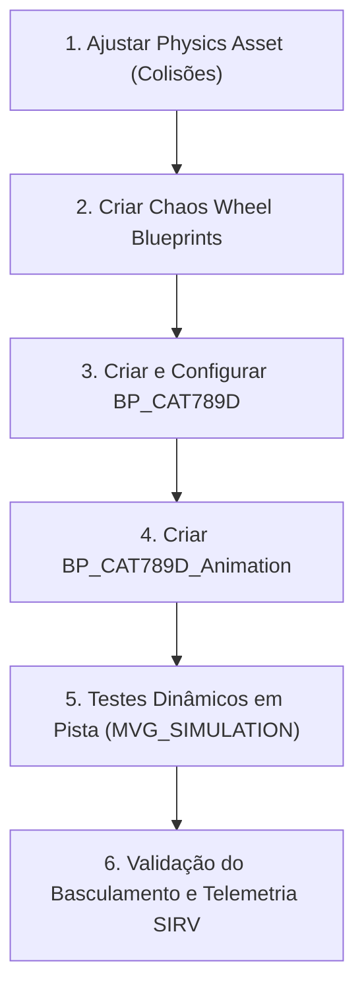

# Validação e Próximos Passos: Caminhão Fora de Estrada CAT 789D na Unreal Engine 5

Este documento consolida **todo o trabalho técnico realizado até o momento**, as correções geométricas/estruturais aplicadas no modelo 3D do **Caterpillar 789D**, a estratégia de **reaproveitamento da arquitetura do CAT 793F** e o **roteiro detalhado de validação e implementação** na Unreal Engine 5.

---

## 1. Resumo do Trabalho Realizado (Histórico & Engenharia do Rig)

### 1.1 Preparação do Ambiente e Decomposição da Malha
* **Ambiente Blender 5.2.1 LTS**: Configurado com aceleração gráfica dedicada NVIDIA via PRIME Offload.
* **Inspeção do Blend Original (`Caminhao Fora de Estrada - CAT 1.blend`)**:
  * O modelo original continha peças soltas não padronizadas e as 4 rodas traseiras estavam agrupadas em um único objeto (`wheels.008`).
  * **Separação Topológica**: Via script Python com `bmesh`, as 4 ilhas de malha foram isoladas em 4 objetos individuais: `Wheel_TL` (Trailer Left), `Wheel_IL` (Inside Left), `Wheel_IR` (Inside Right) e `Wheel_TR` (Trailer Right). As dianteiras foram nomeadas `Wheel_FL` e `Wheel_FR`.
  * **Cálculo de Pivôs Reais**: Localização precisa dos centros dos cubos de roda, eixo de rotação da caçamba (`BasculaRig`) e apoios superior e inferior dos cilindros hidráulicos (`TopPiston` e `BasePiston`).

---

### 1.2 Criação da Armadura e Padronização de Eixos para a UE5
* **Esqueleto (`CAT789D_Armature`)**: Criado com 20 ossos rigorosamente hierarquizados:
  * `VehicleMesh` (Raiz / Root no solo em $0, 0, 0$)
  * 6 Ossos de Rodas: `FL`, `FR`, `IL`, `IR`, `TL`, `TR`
  * Sistema de Báscula: `BasculaRig` $\rightarrow$ `cacamba` $\rightarrow$ `pistonUpperPiece` $\rightarrow$ `TopPiston`
  * Sistema de Pistão Inferior: `pistonBottomPiece` $\rightarrow$ `BasePiston`
  * Acessórios: `VehicleWindows`, `Lights`, 4 retrovisores (`retrovisorDirBaixo`, `retrovisorDirCima`, `retrovisorEsqBaixo`, `retrovisorEsqCima`).
* **Orientação Estrita dos Eixos**:
  * **Local X**: Apontando para a **Frente** (+X Forward).
  * **Local Z**: Apontando para **Cima** (+Z Up).
  * **Local Y**: Apontando para a **Direita** (+Y Right - Convenção Canhota / *Left-Handed* da Unreal Engine).

---

### 1.3 Calibração de Escala Métrica 1:1 e Alinhamento de Solo
* **Conversão para Unreal Units (Centímetros)**:
  * A geometria e o esqueleto foram escalados em **100x nativos**, garantindo dimensões reais fiéis ao equipamento de fábrica:
    * **Comprimento:** $12,88\text{ metros}$ ($1.288\text{ cm}$)
    * **Largura:** $7,87\text{ metros}$ ($787\text{ cm}$)
    * **Altura:** $6,49\text{ metros}$ ($649\text{ cm}$)
    * **Diâmetro dos Pneus:** $3,42\text{ metros}$ ($342\text{ cm}$)
* **Alinhamento do Piso ($Z = 0.0$)**:
  * O ponto mais baixo das 6 bandas de rodagem encosta com precisão milimétrica no plano horizontal $Z = 0$, evitando que o caminhão afunde ou flutue ao ser spawnado.

---

### 1.4 Correções Críticas Realizadas
1. **Canal Único de UV (`UVMap` no Canal 0)**:
   * Corrigida a perda de textura das 4 rodas traseiras (que haviam sido gravadas no canal secundário `Float2`). Todas as 6 rodas e a carroceria agora compartilham o mesmo canal primário com mapeamento completo de sujeira e cubos amarelos.
2. **Suavização dos Pneus (*Shade Smooth*)**:
   * Eliminado o aspecto facetado nas rodas traseiras, deixando os pneus perfeitamente arredondados.
3. **Unificação em *Single Skeletal Mesh* (`CAT789D_Mesh`)**:
   * Todas as 17 peças soltas foram combinadas em uma única malha esquelética limpa vinculada por grupos de vértices de peso 1.0 rígido, eliminando crashes de compilação de shader e de timeout no driver Vulkan da Unreal (`VK_ERROR_DEVICE_LOST`).
4. **Alinhamento Exato dos Ossos e Bounding Box**:
   * Os 20 ossos foram centralizados nos centróides reais de cada peça, eliminando distorções kilométricas na miniatura do esqueleto e sobrecarga no motor de física (*Chaos Physics*).

---

### 1.5 Arquivos Gerados e Disponíveis
* 📁 **Pasta dos Assets 3D Brutos:** [VR - Mining 789D/](file:///home/iago/Documentos/Estagio/VR%20-%20Mining%20789D/)
  * `CAT789D_Rigged.fbx` *(841 KB)*
  * `CAT789D_Rigged.blend` *(7.5 MB)*
  * `build_cat789d_rig.py` *(Script de automação)*
  * `Textures/` *(Todas as 6 texturas originais em alta resolução)*
* 📁 **Pasta do Projeto Unreal Engine:** `/home/iago/Documentos/Unreal Projects/MinaVargemGrande/Content/`
  * `Sirv/Blueprints/Vehicles/CAT789D/` *(SkeletalMesh, Skeleton, PhysicsAsset e Materiais)*
  * `Landscapes/Levels/MVG_SIMULATION.umap` *(Nível da mina atualizado)*

---

## 2. Estratégia de Reaproveitamento do CAT 793F

O projeto já conta com a implementação completa e funcional do **CAT 793F** em `Content/Sirv/Blueprints/Vehicles/CAT793F/`. Como o CAT 789D possui arquitetura e dinâmica de operação análogas, podemos reaproveitar **mais de 90% da lógica de Blueprints**:

```
CAT 793F (Referência Pronta)                CAT 789D (A Implementar)
├── BP_CAT793F (Pawn Vehicle)        ───►   ├── BP_CAT789D (Duplicar & Ajustar)
├── BP_CAT793F_Animation (AnimBP)   ───►   ├── BP_CAT789D_Animation (Reatribuir Ossos)
├── BP_CAT793F_FW (Chaos Front)     ───►   ├── BP_CAT789D_FW (Raio: 171 cm)
├── BP_CAT793F_RW (Chaos Rear)      ───►   ├── BP_CAT789D_RW (Raio: 171 cm)
└── CAT793FTorqueCurve (Curva Motor) ───►  └── CAT789D_TorqueCurve (Calibrar Potência)
```

### Componentes a Reaproveitar:
1. **Blueprints de Rodas Chaos (`ChaosVehicleWheel`)**:
   * **`BP_CAT789D_FW`** (Dianteira):
     * `Steer Angle`: $35^\circ$ a $40^\circ$
     * `Wheel Radius`: $171.0\text{ cm}$
     * `Wheel Width`: $127.0\text{ cm}$
     * `Affected by Handbrake`: False | `Affected by Steering`: True
   * **`BP_CAT789D_RW`** (Traseiras - 4 unidades):
     * `Steer Angle`: $0.0^\circ$
     * `Wheel Radius`: $171.0\text{ cm}$
     * `Wheel Width`: $113.0\text{ cm}$
     * `Affected by Handbrake`: True | `Affected by Engine`: True | `Affected by Steering`: False
2. **Animation Blueprint (`VehicleAnimationInstance`)**:
   * Nó **`Wheel Controller`**: Anima automaticamente o giro e esterçamento dos ossos `FL`, `FR`, `IL`, `IR`, `TL`, `TR`.
   * **Controle da Caçamba e Pistão**:
     * Transform (Modify) Bone no osso `BasculaRig` com rotação em torno do eixo Y local baseada na variável `CaçambaAngle` (0° a 55°).
     * Nó **`Look At`** no osso `pistonUpperPiece` apontando para o osso `pistonBottomPiece` para manter a haste telescópica sempre alinhada e estendendo durante o basculamento.
3. **Curva de Torque e Transmissão (`ChaosVehicleMovementComponent`)**:
   * Motor CAT C175-16: Potência nominal de 2.100 HP (~1.566 kW).
   * Massa ajustada: ~324.000 kg (peso bruto operacional).
   * Relações de marchas: 6 marchas à frente e 1 marcha à ré.

---

## 3. Reativação do Plugin SIRV & Integração de Telemetria

O plugin **SIRV** fornece a ponte de comunicação com o simulador (cabine física com volante, pedais, alavancas e painel VIMS):

1. **Ativação no `.uproject`**:
   * No arquivo `MinaVargemGrande.uproject` da outra máquina, garantir que o plugin `SIRV` esteja marcado com `"Enabled": true`.
2. **Entradas de Hardware do Operador**:
   * Mapeamento dos eixos de aceleração, freio de serviço, retardador dinâmico e esterçamento.
   * Alavanca de basculamento da caçamba (*Hoist Lever*): Posições *Raise*, *Hold*, *Float* e *Lower*.
3. **SpeedZones e Telemetria**:
   * O script `export_speed_zones.py` e os atores `BP_SpeedZone` do nível `MVG_SIMULATION` fornecem os limites de velocidade das praças e entroncamentos (`INT1` a `INT15`), que são exibidos na tela VIMS do cockpit.

---

## 4. Roteiro Passo a Passo para Validação do CAT 789D

A validação na máquina de simulação deve seguir as etapas abaixo:



---

### Etapa 1: Validação do Physics Asset (`CAT789D_Rigged_PhysicsAsset`)
1. Abrir o `CAT789D_Rigged_PhysicsAsset` na Unreal Engine.
2. **Chassi (`VehicleMesh`)**:
   * Tipo de colisão: Caixa ou casco convexo cobrindo a estrutura principal do caminhão.
3. **Rodas (`FL`, `FR`, `IL`, `IR`, `TL`, `TR`)**:
   * Tipo: Esferas ou cilindros com raio de $171\text{ cm}$.
   * **IMPORTANTE**: No Physics Asset, desative a colisão física direta das rodas (*Collision Response: Disabled* ou *Kinematic*), pois a colisão de rolagem do veículo é calculada pelos Raycasts/Shapecasts do `ChaosVehicleMovementComponent`.
4. **Caçamba (`cacamba`)**:
   * Casco convexo cobrindo a caçamba para suportar o carregamento de minério.

---

### Etapa 2: Configuração do `BP_CAT789D` (Pawn do Veículo)
1. Na pasta `Content/Sirv/Blueprints/Vehicles/`, duplicar o `BP_CAT793F` e renomear para `BP_CAT789D`.
2. Abrir o `BP_CAT789D`:
   * No componente **Mesh (SkeletalMeshComponent)**:
     * Definir `Skeletal Mesh` = `CAT789D_Rigged`.
     * Definir `Anim Class` = `BP_CAT789D_Animation`.
3. No componente **VehicleMovement (ChaosVehicleMovementComponent)**:
   * Abrir o array **`Wheel Setups`** e configurar as 6 rodas:
     * **Element 0**: `Bone Name` = `FL` | `Wheel Class` = `BP_CAT789D_FW` | `Additional Offset` = $(0, 0, 0)$
     * **Element 1**: `Bone Name` = `FR` | `Wheel Class` = `BP_CAT789D_FW` | `Additional Offset` = $(0, 0, 0)$
     * **Element 2**: `Bone Name` = `IL` | `Wheel Class` = `BP_CAT789D_RW` | `Additional Offset` = $(0, 0, 0)$
     * **Element 3**: `Bone Name` = `IR` | `Wheel Class` = `BP_CAT789D_RW` | `Additional Offset` = $(0, 0, 0)$
     * **Element 4**: `Bone Name` = `TL` | `Wheel Class` = `BP_CAT789D_RW` | `Additional Offset` = $(0, 0, 0)$
     * **Element 5**: `Bone Name` = `TR` | `Wheel Class` = `BP_CAT789D_RW` | `Additional Offset` = $(0, 0, 0)$
   * **Massa do Veículo**: Ajustar para $324.000\text{ kg}$.
   * **Centro de Massa (COM Offset)**: Definir próximo de $(0, 0, 180)$ para estabilidade realista em curvas.

---

### Etapa 3: Configuração do Animation Blueprint (`BP_CAT789D_Animation`)
1. Duplicar `BP_CAT793F_Animation` e renomear para `BP_CAT789D_Animation`.
2. Reatribuir o Skeleton alvo para `CAT789D_Rigged_Skeleton`.
3. No **Anim Graph**:
   * Manter o nó **`Wheel Controller`** (ele mapeará automaticamente os 6 ossos de roda configurados no Chaos Vehicle).
   * Verificar a rotação da caçamba e os nós de pistão hidráulico (*Look At* apontando de `pistonUpperPiece` para `pistonBottomPiece`).

---

### Etapa 4: Bateria de Testes no Nível `MVG_SIMULATION`
1. **Posicionamento**:
   * Arraste o `BP_CAT789D` para a praça de saída da mina ou perto do ponto de interesse de partida.
   * Defina `Auto Possess Player = Player 0` ou entre com a câmera de simulação.
2. **Critérios de Aceite nos Testes**:
   * [ ] **Aceleração e Velocidade**: O caminhão acelera suavemente até a velocidade máxima de ~55 km/h em pista plana.
   * [ ] **Esterçamento das Rodas**: Ao virar para a esquerda/direita, apenas as rodas `FL` e `FR` esterçam; as 4 rodas traseiras permanecem retas e giram com a tração.
   * [ ] **Estabilidade em Rampas**: Subida e descida com carga sem capotamento ou perda excessiva de aderência.
   * [ ] **Basculamento da Caçamba**: Ao acionar a alavanca de báscula, a caçamba ergue suavemente até 55° e os pistões estendem sem dessincronização visual.
   * [ ] **Câmeras do Cockpit e Espelhos**: Visão interna do motorista alinhada com o painel e retrovisores exibindo a pista traseira corretamente.
   * [ ] **Integração SIRV e SpeedZones**: O caminhão responde aos limites de velocidade definidos nas zonas do mapa e envia os dados de telemetria esperados.

---

## 5. Conclusão e Prontidão
O caminhão **Caterpillar 789D** está totalmente calibrado, com malha unificada, eixos no padrão oficial da Unreal Engine 5, texturas em alta resolução e empacotamento completo. O reaproveitamento da lógica do **CAT 793F** garante que o processo de validação seja rápido, robusto e com máxima compatibilidade no simulador.
